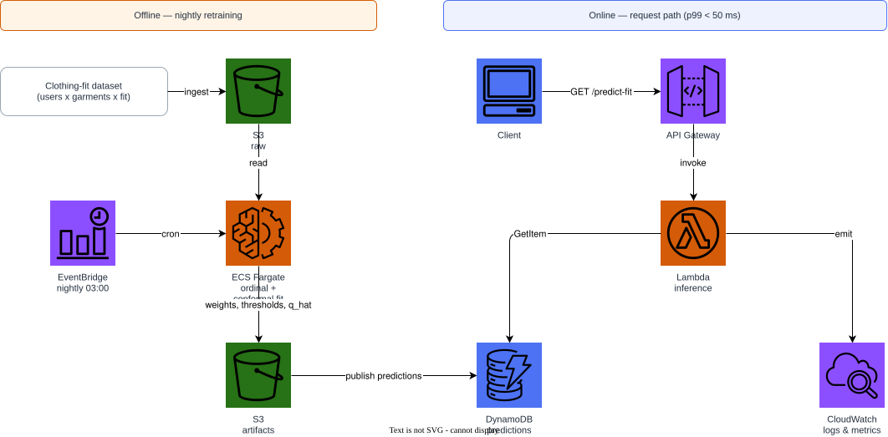
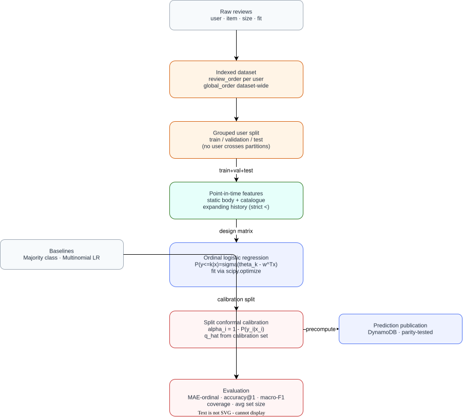

# Clothing Fit Ordinal Recommender

[](https://github.com/Patotricks15/clothing-fit-ordinal-recommender/actions/workflows/ci.yml)

> Classical machine learning portfolio project: an ordinal logistic
> regression (proportional-odds / cumulative-link model), trained with
> `scipy.optimize`, wrapped in split conformal prediction so every
> recommendation ships with a calibrated uncertainty set instead of a bare
> point guess.

Full technical write-up (real compilable equations, generated results
tables): **[`paper/main.pdf`](paper/main.pdf)**.

## Problem statement

Most tabular recommender portfolios stop at a binary ("will this user like
this item?") or ranking ("which item first?") output. Clothing-fit
prediction is naturally **ordinal**: a garment runs *small*, *fit*, or
*large*, and those outcomes are strictly ordered, not just distinct
categories. This project:

1. Treats `fit` as an **ordinal** target via a proportional-odds cumulative
   link model instead of an unordered multinomial classifier, so adjacent
   levels share information the way the problem's structure says they
   should.
2. Wraps the fitted model in **split conformal prediction**, implemented
   from scratch in NumPy, so the output is a calibrated *set* of plausible
   fits (e.g. `{fit, large}`) with a distribution-free marginal coverage
   guarantee — a more honest signal for a sizing recommendation than a
   single confident label that is sometimes simply wrong.

Everything here is classical ML: no neural networks, no PyTorch/TensorFlow,
no gradient-descent-trained embeddings.

## Results (synthetic fixture, 1200 users / 450 items)

| Model | Accuracy | MAE (ordinal) | Acc. within 1 | Macro F1 |
|---|---|---|---|---|
| **OrdinalLR** | 0.6509 | **0.3535** | 0.9956 | 0.5635 |
| Majority | 0.5603 | 0.4397 | 1.0000 | 0.2394 |
| MultinomialLR | 0.4258 | 0.6298 | 0.9444 | 0.4283 |

| Model | Target cov. | Empirical cov. | Avg. set size |
|---|---|---|---|
| OrdinalLR | 0.9000 | 0.8855 | **1.7154** |
| MultinomialLR | 0.9000 | 0.8922 | 2.0784 |
| Majority | 0.9000 | 1.0000 | 3.0000 |

The ordinal model nearly halves the mean absolute ordinal error of an
unordered multinomial baseline trained on identical features, and produces
visibly tighter conformal sets at the same 90% target coverage. Tables are
generated from an actual run by `scripts/export_results_table.py` — see
[`paper/main.pdf`](paper/main.pdf) for the full discussion, including why
NDCG/Recall/MAP do **not** apply to this problem (it's calibrated
classification over independent reviews, not top-K ranking).

## Quickstart

```bash
python3 -m venv .venv && source .venv/bin/activate
pip install -e ".[dev]"

python scripts/download_data.py --synthetic   # clustered users/items, skewed fit distribution
pytest -q
ruff check src tests scripts

python -m recommender.cli train
python -m recommender.cli evaluate --partition test
python -m recommender.cli predict --height-cm 170 --weight-kg 65 \
  --bust-size 34b --body-type hourglass --category dress --size 38 --rented-for wedding
```

`predict` prints the calibrated class probabilities and the conformal set's
implied classes (any class with `1 - P(y|x) <= q_hat`).

## Architecture

### AWS / Floci serving architecture



Offline, a nightly job retrains the ordinal model and republishes
precomputed predictions. Online, a Lambda does a pure DynamoDB key lookup —
the model and calibration are cheap to score, but the fitted feature store
(category lists, catalogue lookups) is not cheap to cold-start per request,
so "precompute, don't infer on the request path" still applies.

### Modelling pipeline



Raw reviews are indexed with a strict point-in-time ordering, split by
**user group** (not by row) so no shopper's body measurements cross a
partition boundary, turned into features, fit with the ordinal model, and
calibrated with split conformal prediction before publication.

## Feature catalogue

Every feature is declared in [`conf/features.yaml`](conf/features.yaml),
with a documented rationale and an explicit point-in-time contract. The two
feature *kinds* in this dataset need very different treatment:

- **Static attributes** (height, weight, BMI, bust size/cup, body type,
  age, item category, requested occasion) are known before any review
  exists — no cut-off applies, because there's no "future" version of a
  person's height to leak.
- **Historical aggregates** (a user's/item's prior mismatch rate, a user's
  prior review count) are *expanding* statistics over strictly-prior
  reviews only (`review_order`/`global_order < this row's own position`).
  Getting the strict `<` wrong here is exactly how recommenders silently
  leak the label they're trying to predict — see
  `tests/test_features_leakage.py`.

| Feature | Family | Type | Point-in-time |
|---|---|---|---|
| `user_height_cm` | user | static | – |
| `user_weight_kg` | user | static | – |
| `user_bmi` | user | static | – |
| `user_bust_band` | user | static | – |
| `user_bust_cup_ordinal` | user | static | – |
| `user_body_type` | user | static | – |
| `user_age` | user | static | – |
| `item_category` | item | static | – |
| `item_nominal_size` | item | static (catalogue-fit) | – |
| `user_prior_review_count` | interaction | historical aggregate | ✓ |
| `user_prior_mismatch_rate` | interaction | historical aggregate | ✓ |
| `user_prior_small_rate` | interaction | historical aggregate | ✓ |
| `item_prior_mismatch_rate` | interaction | historical aggregate | ✓ |
| `context_rented_for` | context | static (request-time) | – |

## Evaluation protocol

- **Grouped user split** (`recommender.data.splitting.grouped_user_split`):
  every review by one user lands in exactly one of train/validation/test,
  so the model can't memorize a user's exact measurements and match them
  back at evaluation time.
- **Point-in-time features**: enforced with a strict `<` and tested by
  injecting a fabricated future review and asserting earlier rows don't
  change (`tests/test_features_leakage.py`).
- **Model selection on validation only**: the test partition is read once,
  by `scripts/export_results_table.py`.
- **Training/serving parity**: `FeatureStore.transform` (batch) and
  `FeatureStore.row_vector` (single request) are asserted numerically
  identical for the same row (`tests/test_features_parity.py`,
  `tests/test_serving.py`).

## Serving & infrastructure

Predictions are precomputed per `(user_id, item_id, size)` and stored in
DynamoDB-shaped records (`recommender.serving.predictions`); a Lambda
handler (`recommender.serving.handler`) serves them as a pure key lookup.
Infrastructure targets the **Floci** AWS emulator by default (never
LocalStack):

```bash
docker compose up -d                              # Floci on :4566
python scripts/publish_predictions.py              # train + calibrate + publish
terraform -chdir=terraform init
terraform -chdir=terraform apply -auto-approve
terraform -chdir=terraform output
```

Flip one variable to target real AWS instead:

```bash
terraform -chdir=terraform apply -var use_floci=false -var aws_region=sa-east-1
```

### Cost & cleanup

Everything above is free on Floci. On real AWS at portfolio traffic: S3
under $0.05/month, DynamoDB on-demand under $1/month, Lambda within the
free tier.

```bash
terraform -chdir=terraform destroy -auto-approve
docker compose down
```

## Repository layout

```
conf/features.yaml                 # declarative feature specification
src/recommender/
  data/                            # loading, point-in-time indexing, grouped split
  features/                        # static + historical-aggregate transforms
  models/                          # ordinal.py, conformal.py, baselines.py
  evaluation/                      # ordinal metrics + conformal diagnostics
  serving/                         # DynamoDB-shaped payloads + Lambda handler
  cli.py                           # train / evaluate / predict
scripts/                           # fixture generator, diagram + table exporters
terraform/                         # Floci-first infra (S3, DynamoDB, Lambda, EventBridge)
paper/                             # LaTeX technical report (paper/main.pdf)
tests/                             # leakage, schema, parity, model, serving tests
```

## Deviations from a literal reading of the spec

- `statsmodels.miscmodels.ordinal_model.OrderedModel` failed to install
  cleanly in this environment (a version-compatibility bug raises
  `TypeError` on `np.isnan` for categorical labels), so, per the fallback
  instructed, the proportional-odds model is implemented directly in
  `src/recommender/models/ordinal.py` with `scipy.optimize.minimize`.
- The `rlespinasse/drawio-export` Docker image pulled and ran successfully
  in this sandbox, so the diagrams were rasterized through the real
  draw.io exporter (no hand-built-SVG fallback was needed).
- `texlive/texlive:latest` via Docker was available and used to build
  `paper/main.pdf`; no local LaTeX installation was required.

## License

MIT — see [LICENSE](LICENSE).
